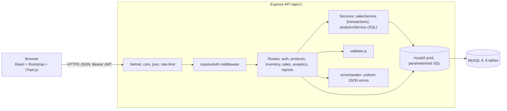

# Architecture



## Request lifecycle (create a sale)
1. React `Sales` page builds the cart (state via `useState`), validates quantities, sends `POST /sales` with an idempotency key.
2. `requireAuth` verifies the JWT. `validate.js` checks items.
3. `salesService.createSale` opens a transaction, locks products, checks stock, prices lines from DB values, inserts sale + items, reduces stock, writes movements, commits.
4. Errors become `AppError` → `errorHandler` → `{success:false,error}`; the UI shows the message in the confirm dialog.

## Folder structure
```
smart-inventory/
├─ backend/
│  ├─ sql/            schema.sql, analytics_queries.sql
│  ├─ src/
│  │  ├─ config/      env.js (validated .env), db.js (pool, IST)
│  │  ├─ middleware/  auth.js, errorHandler.js
│  │  ├─ routes/      auth, categories, products, inventory, sales, analytics, reports
│  │  ├─ services/    salesService.js (transactions), analyticsService.js (all KPI SQL)
│  │  ├─ utils/       validate, csv, errors, respond, initDb, seed
│  │  ├─ app.js       builds Express app (testable)   server.js  starts it
│  └─ tests/          helpers + auth, products, sales, analytics test files
├─ frontend/src/
│  ├─ api/client.js   the only place that calls fetch
│  ├─ components/     Layout, ui (Modal, Field, Pagination…), charts, Toast, AuthContext
│  ├─ pages/          Login, Dashboard, Products, Inventory, Sales, Analytics, Reports
│  └─ utils/          format (INR, dates), useFetch (loading/error/reload hook)
└─ docs/              this documentation, Postman collection, browser check script
```

## Key design decisions
* **Calculations live in SQL/backend**: the dashboard, analytics page and CSV exports call the same `analyticsService` functions, so numbers on screen and in exports cannot disagree.
* **Express 5** forwards errors from async handlers automatically, so route code has no try/catch boilerplate.
* **Vite dev proxy** (`/api` → `:5000`) avoids CORS in development; in production set `VITE_API_URL` and `CORS_ORIGIN`.
* **React**: function components, props, `useState`/`useEffect`, a small `useFetch` hook returning `{data, loading, error, reload}`, and an `Async` wrapper that guarantees loading / error / empty / data states on every screen.
