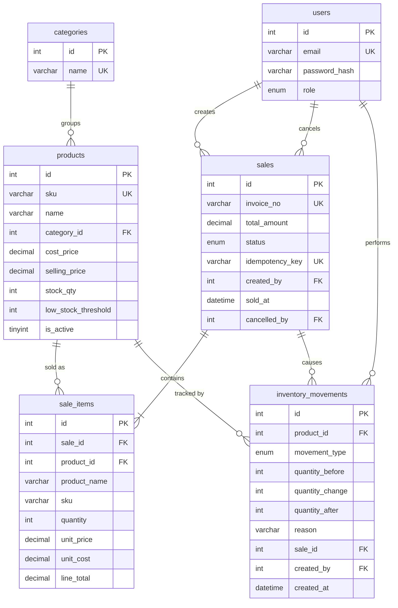

# Database design (MySQL 8, InnoDB, utf8mb4)

Schema file: `backend/sql/schema.sql` · Seed: `backend/src/utils/seed.js` (deterministic, ~6 months of history).

## ER diagram

## Entities
| Table | Purpose | Key constraints / indexes |
|---|---|---|
| `users` | Admin accounts. Only a bcrypt **hash** is stored. | PK `id`; UNIQUE `email` |
| `categories` | Product groups for filters and category analytics. | UNIQUE `name` |
| `products` | Catalogue + **current** stock. `is_active=0` means archived. | UNIQUE `sku`; FK `category_id`; CHECK cost/price ≥ 0; `stock_qty` and threshold are `INT UNSIGNED` (negative stock is impossible at DB level); index `(is_active,name)` |
| `sales` | Sale header: invoice, total, status (`COMPLETED`/`CANCELLED`), who/when, cancellation audit. | UNIQUE `invoice_no`, UNIQUE `idempotency_key` (duplicate-submit guard); indexes `sold_at`, `(status,sold_at)` for date-range analytics |
| `sale_items` | Sale lines. **Snapshot** of name, SKU, `unit_price`, `unit_cost`. | FK `sale_id` (cascade), FK `product_id`; CHECK `quantity>0`; indexes on both FKs |
| `inventory_movements` | Append-only stock ledger: before / change / after, reason, user, linked sale. | FKs; indexes `(product_id,created_at)`, `created_at` |

All six tables are the minimum set from the brief; **no extra tables were added** (the ledger and snapshots cover auditability without them).

## Relationships
* One category → many products. One product → many sale lines and many movements.
* One sale → one or more lines (`1..N`) and zero or more movements (sale + reversal rows).
* `sales.created_by` and `sales.cancelled_by` both reference `users` (two roles of the same entity).

## Normalisation note (for viva)
The schema is in 3NF for operational data. `sale_items.product_name/sku/unit_price/unit_cost` and `sales.total_amount` are **deliberate, controlled denormalisation**: they freeze history so renaming a product, changing its price, or changing its cost never rewrites past sales or profit. `products.stock_qty` is a cached running total of `inventory_movements`; the seed and tests verify `stock_qty = Σ quantity_change` for every product.

## Data-integrity mechanisms
1. **One transaction per sale**: header + lines + stock reduction + movement rows commit together or roll back together.
2. **Row locks**: `SELECT … FOR UPDATE` on the products involved, taken in ascending id order (no deadlocks). Two simultaneous buyers of the last unit are serialised; the second is refused with "Insufficient stock".
3. **Server-side money**: totals and prices come from the database; line maths is done in integer paise, then stored in `DECIMAL(12,2)`.
4. **Idempotency key** (UNIQUE) makes a retry or double-click return the original sale.
5. **No silent stock edits**: product edits cannot change stock; only sales, cancellations and `/inventory/adjust` do, and each writes a movement row.
6. **Cancellation, not deletion**: status flips to `CANCELLED`, stock is returned via `SALE_REVERSAL` rows, and analytics exclude it.
7. **Archive, not delete**: products with history can never be removed, so foreign keys always resolve.
8. **Database safety nets**: `UNSIGNED` stock, `CHECK` constraints, FKs, unique keys.

## Conventions
* Money `DECIMAL(12,2)`; quantities `INT`. mysql2 returns DECIMAL as numbers (`decimalNumbers`).
* **Time zone:** every DATETIME is stored in **IST (UTC+05:30)**. Each pooled connection runs `SET time_zone='+05:30'`, so `NOW()` is IST wherever the server runs. Dates travel as plain `YYYY-MM-DD HH:mm:ss` strings (`dateStrings`), so browsers never shift them. Trade-off: fine for a single-region shop; a multi-region system should store UTC.
* Date filters use `sold_at >= from 00:00:00 AND sold_at < (to + 1 day) 00:00:00` so the whole last day is included and indexes are used.

## Verified invariants (executed on the seeded database)
`stock_qty = Σ movements` (0 violations) · `sales.total = Σ line_total` (0) · `before + change = after` (0) · every cancelled sale has reversal rows (0 missing) · no future-dated rows (0).
